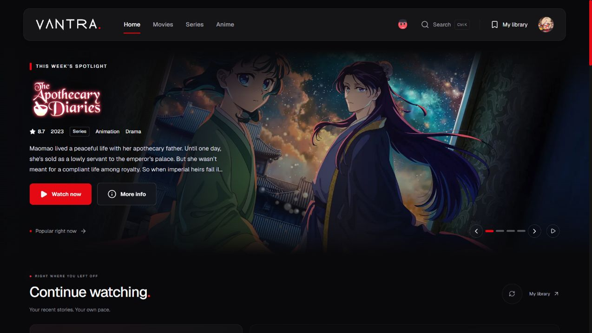
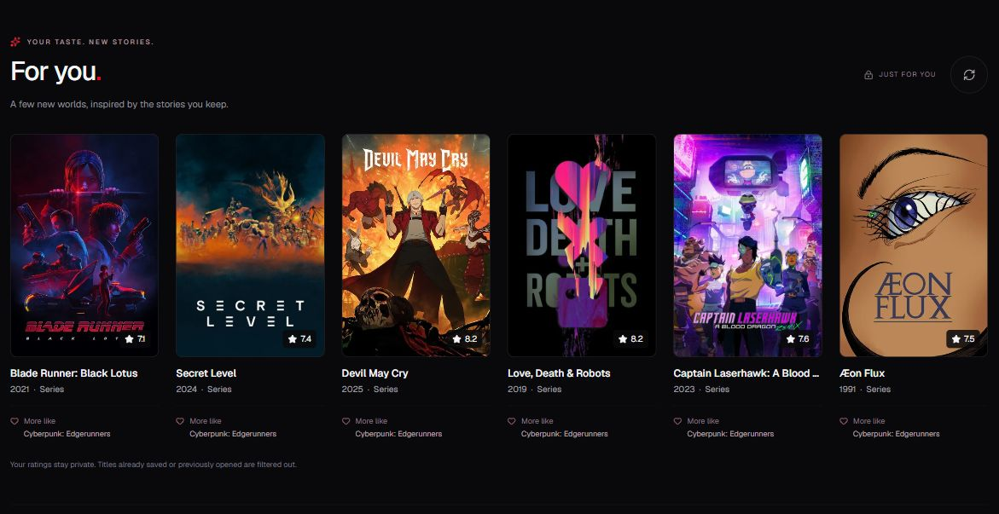
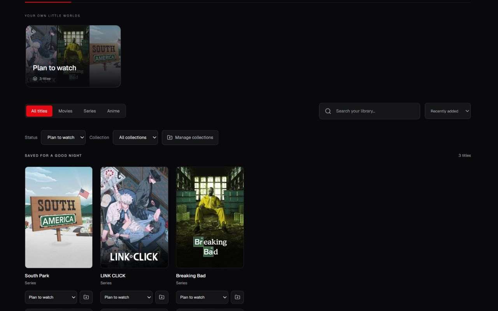
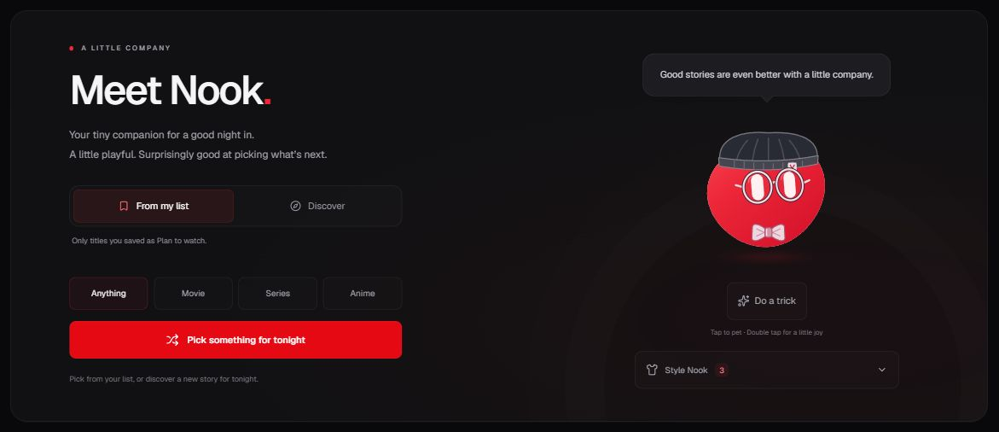
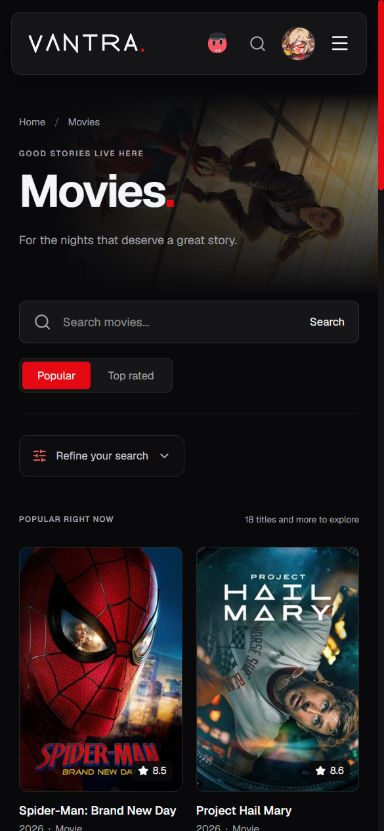

# VANTRA

A private space for movies, series and anime.

VANTRA started as a personal learning project for a small group of friends. It has since grown into a complete visual overhaul with a personal library, manual episode tracking, recommendations and a small animated companion called Nook. It remains non-commercial and in active development.



## Features

- **Discover:** browse movies, series and anime, search by title, refine results with filters, and explore cast members and their other work. Catalogues load 18 titles at a time.
- **Your library:** save titles, manage watching status, build collections, and keep private ratings and notes separate from official catalogue scores.
- **Episode tracking:** mark individual episodes or a released season watched, undo a season's marks, and see watched counts in the season picker.
- **Continue watching:** up to three titles with the next unmarked episode or the last episode opened. Caught-up titles and future releases stay out of the shelf. Completed titles can return with newly released episodes according to their completion date and watched marks.
- **For you:** six recommendations inspired by your highly rated, watching or completed titles. Already saved and previously opened titles are filtered out.
- **Nook:** an animated companion with gaze tracking, pet interactions, tricks and genre reactions. Ask for a pick from your planned list or discover something new. Beanie, glasses and bow tie preferences are remembered per account in the current browser. Nook also presents community reviews on supported detail pages and stays off the playback page.
- **Your account:** a shared avatar, profile settings and private library statistics. A separate owner-only panel automatically measures database and file-storage capacity.
- **Consistent design:** dark surfaces, red accents, poster cards, title artwork, animated search and responsive layouts with reduced-motion support.

## A closer look

### Personal recommendations

Each suggestion explains which story inspired it. The scores shown on these cards are catalogue scores; your own ratings and notes stay in My Library.



### Title details

Film, series and anime pages share the same visual language, with title artwork, trailers, cast, galleries and episode information where available.


<details>
<summary>See the library, Nook and mobile layout</summary>

### Library

Collections, watching status and private review controls. This view shows planned titles without personal review text.



### Meet Nook

A quiet place to pick the next story, with the same companion available from the navigation.



### On a smaller screen



</details>

## How it works

TMDB provides movie and series metadata. AniList supplies anime metadata through GraphQL. VANTRA's server routes validate catalogue requests and keep the TMDB API key on the server.

Supabase handles authentication, PostgreSQL data and avatar storage. Access is restricted to approved accounts through an email whitelist. Row Level Security limits profiles, saved titles, history, reviews, collections and watched marks to their owner.

Playback comes from external providers embedded in iframes. VANTRA does not host or upload video files. The surrounding source picker and navigation belong to VANTRA; the video controls, subtitle options and quality choices depend on the selected provider.

## Playback sources and advertising

Playback availability varies by title, episode, region and time. Some providers offer broader availability while also displaying advertisements or opening popups. The source picker uses an `ADS` badge to flag some advertising-supported sources. Other sources may also serve ads.

An updated browser and a reputable content blocker are recommended:

- **Firefox and Zen:** [uBlock Origin from Firefox Add-ons](https://addons.mozilla.org/en-US/firefox/addon/ublock-origin/). Zen supports Firefox extensions.
- **Chrome and Edge:** [uBlock Origin Lite](https://github.com/uBlockOrigin/uBOL-home), using the official store links listed by the project.

A blocker reduces unwanted ads and popups but does not guarantee safety. VANTRA does not control third-party advertising. Avoid entering credentials, installing software or granting permissions in provider and advertisement prompts. VANTRA's iframe permission restrictions are an additional layer, not a built-in ad blocker.

## Tech stack

| Technology | Role |
|---|---|
| Next.js 16 and React 19 | App Router, server routes and interface |
| TypeScript | Application types and request validation |
| CSS Modules and Tailwind CSS 4 | Shared theme and responsive styling |
| Framer Motion | Interface transitions and animations |
| Supabase | Authentication, PostgreSQL, RLS and avatar storage |
| TMDB | Movie, series, artwork and people data |
| AniList | Anime metadata and community recommendations |

## Run locally

Use Node.js 24 and npm. The test suite uses Node's native TypeScript support.

```sh
git clone https://github.com/balusikf/Vantra.git
cd Vantra
npm ci
cp .env.example .env.local
```

Fill in `.env.local`:

| Variable | Purpose |
|---|---|
| `NEXT_PUBLIC_SUPABASE_URL` | Supabase project URL |
| `NEXT_PUBLIC_SUPABASE_ANON_KEY` | Public publishable key or legacy anon key |
| `TMDB_API_KEY` | Server-side TMDB API key |
| `VANTRA_OWNER_USER_ID` | Optional server-only UUID for the capacity panel; must match its database authorization |

Keep `.env.local` private. A Supabase service-role or secret key must never be placed in a `NEXT_PUBLIC_` variable.

The app requires a prepared Supabase project with VANTRA's tables, RLS policies, functions, approved accounts and avatar bucket. The files in [docs/sql](docs/sql) record changes already applied to the existing project. They are deployment references, not a fresh-project installer. Review their notes before using them on another database.

```sh
npm run dev
```

Open [localhost:3000](http://localhost:3000) and sign in with an approved account. Restart the server after changing environment variables.

For a local production build:

```sh
npm run build
npm start
```

## Checks and project notes

```sh
npm test
npm run lint
npm run build
```

Public catalogue metadata uses bounded caches, shared in-flight requests and provider cooldowns. Personal data stays outside the shared catalogue cache. The recommendation shelf loads near the viewport, and its library exclusions are checked against the current account.

Useful implementation notes:

- [Personal recommendations and end-to-end checks](docs/FOR-YOU.md)
- [Continue watching and its limits](docs/CONTINUE-WATCHING.md)
- [Library tracking and collections](docs/LIBRARY-TRACKING.md)
- [Nook and its appearance](docs/NOOK.md)
- [Automatic owner capacity panel](docs/OWNER-USAGE-PANEL.md)
- [Latest efficiency and security audit](docs/AUDIT-2026-10-24.md)
- [Code and privacy review](docs/SECURITY-REVIEW-2026-10-24.md)
- [Embedded-player security](docs/PLAYER-SECURITY.md)

### Current limits

Watch history records the last title or episode opened. It does not prove that an episode was finished. Continue watching uses manual marks and episode identity; reliable playback timestamps depend on the provider.

Recommendations exclude exact catalogue identities. An equivalent work stored separately under TMDB and AniList is not automatically matched across both services. Recommendations and episode dates also cannot guarantee that a streaming source has the title available.

The owner capacity panel shows current database and stored-file sizes. Monthly egress, active users and other billing totals remain in the Supabase dashboard.

A fully custom direct-stream player, unified subtitle handling, PWA support, TV mode and automated deployment are still outside the current implementation.

## What I learned

This project has been a practical way to learn how a full-stack application fits together:

- App Router navigation, server and client components, and dynamic routes.
- PostgreSQL ownership rules, RLS, authentication and file storage.
- REST and GraphQL integrations, caching, outages and request validation.
- Reusable components, responsive layouts and animation performance.
- The limits of embedding a player from another origin.
- Version control and keeping credentials out of the repository.

The most useful lesson has been that the interface is only one part of the project. Reliable data, clear state, access rules and honest handling of external services matter just as much.

## Credits

Originally built with assistance from [Claude](https://claude.ai). The current visual overhaul and subsequent features were developed with assistance from Codex, including implementation, debugging and verification.

- Movie and series data and artwork: [TMDB](https://www.themoviedb.org/).
- Anime data: [AniList](https://anilist.co/).
- Nook is adapted from [bloub by Jérémy Perret](https://github.com/jeremy-prt/bloub). Its [MIT license](src/vendor/bloub/LICENSE) is retained with the vendored code.

VANTRA is a personal, non-commercial learning project intended for private use. Video playback is supplied by external services.
