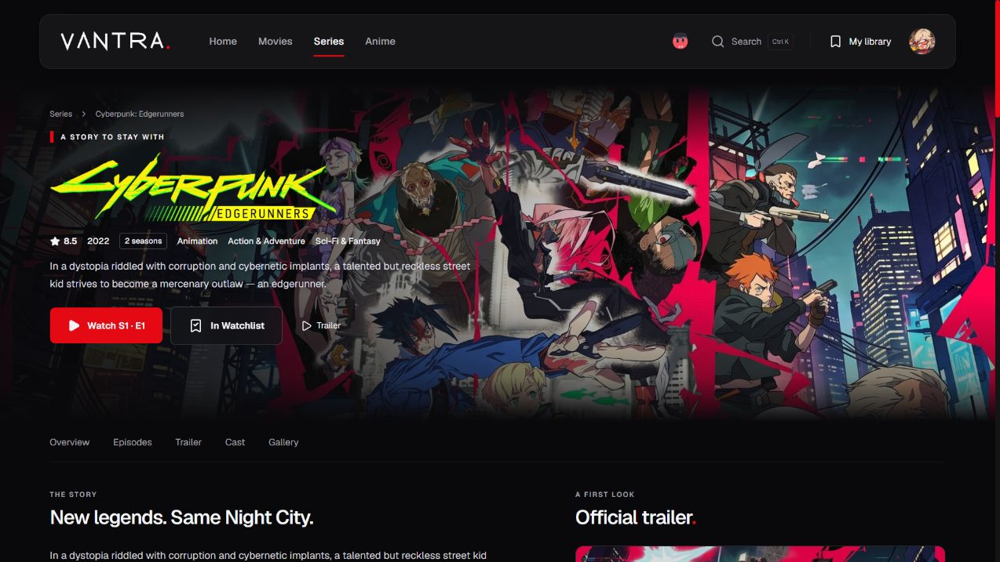
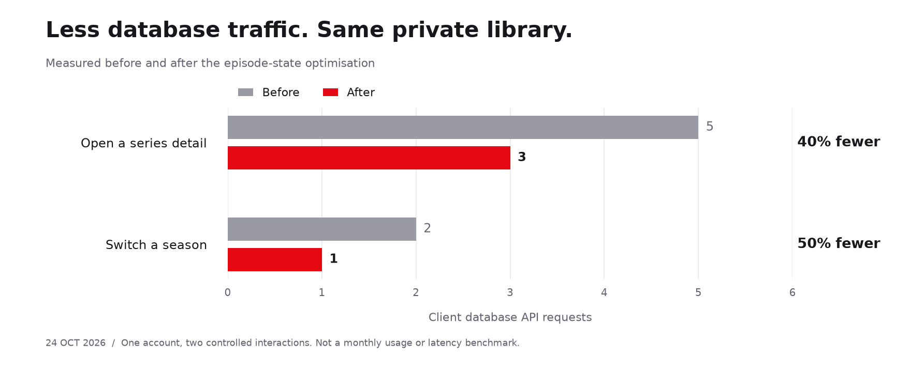
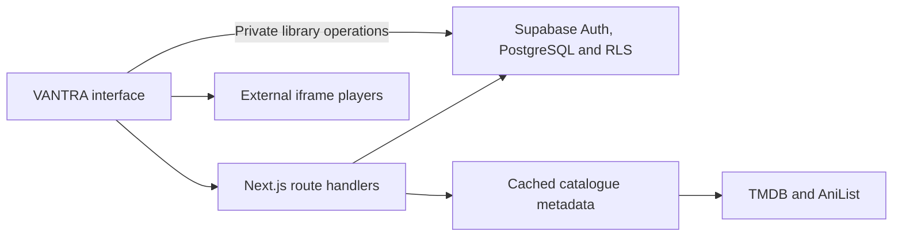

<p align="center">
  <picture>
    <source media="(prefers-color-scheme: dark)" srcset="docs/assets/vantra-wordmark-dark.svg">
    
  </picture>
</p>

<p align="center"><strong>Good stories live here.</strong></p>

<p align="center">
  A personal home for movies, series and anime.<br>
  Discover a story, keep it in your library and find your next episode.
</p>

<p align="center">
  <a href="docs/GETTING-STARTED.md">Get started</a> ·
  <a href="docs/README.md">Documentation</a> ·
  <a href="docs/ARCHITECTURE.md">Architecture</a> ·
  <a href="docs/ROADMAP.md">Roadmap</a>
</p>

<p align="center"><sub>Next.js 16 · React 19 · TypeScript · Supabase</sub></p>



VANTRA is a non-commercial web application in active development, with access intended for approved accounts. It combines public catalogue metadata, a private viewing library and playback through external embedded sources.

## The experience

| Area | What you can do |
| --- | --- |
| Discover | Browse movies, series and anime, refine searches, explore cast profiles and connected film collections |
| Keep a library | Organise statuses and collections; save private ratings and notes separately from official scores |
| Follow a story | Mark episodes or released seasons watched; see up to three eligible titles in Continue watching |
| Find something new | Explore personal recommendations or ask Nook to choose from your planned list or the wider catalogue |
| Make it yours | Set a profile and avatar, customise Nook and explore private library statistics |
| Watch with context | Choose an external source, use playback recovery and view available anime episode details and filler labels |

Catalogues load 18 titles per page. The interface shares one visual theme, original title artwork, keyboard controls and reduced-motion support. [Explore the gallery](docs/GALLERY.md).

## Database efficiency

The recorded TV-detail comparison reduced **client database requests from 5 to 3**, a **40% reduction**. Changing seasons went from **2 requests to 1**.

<picture>
  <source media="(prefers-color-scheme: dark)" srcset="docs/assets/database-requests-dark.png">
  
</picture>

Measured on 24 October 2026 in two controlled interactions. These are request counts, not a claim about monthly billing, database CPU or overall page speed. [Method, raw evidence and limits](docs/PERFORMANCE.md).

## How it fits together



Supabase stores personal account data and avatars. Catalogue metadata uses separate bounded caches; video files are served externally. Private notes, library entries and sessions stay outside shared catalogue caches. [Architecture and data model](docs/ARCHITECTURE.md).

## Run locally

Use Node.js 24 and npm. A prepared Supabase schema and an approved account are required; the SQL references are not a fresh-project installer.

```sh
git clone https://github.com/balusikf/Vantra.git
cd Vantra
npm ci
cp .env.example .env.local
```

Fill in your own environment values using the [setup guide](docs/GETTING-STARTED.md), then run:

```sh
npm run dev
```

Open [localhost:3000](http://localhost:3000). Keep `.env.local` private.

## Playback and limits

Sources are embedded through iframes. Availability, quality, audio, subtitles and playback positions depend on the selected source. Some sources contain advertisements or popups. An updated browser and a reputable content blocker are recommended; they do not guarantee safety.

Opening a player records the last title or episode opened, not confirmed completion. Watched progress uses explicit marks. The owner capacity panel measures current database and file sizes; monthly billing totals remain in the Supabase dashboard. [Playback details](docs/PLAYBACK.md).

## Documentation

| Topic | Guide |
| --- | --- |
| Setup and commands | [Getting started](docs/GETTING-STARTED.md) |
| Structure and privacy | [Architecture](docs/ARCHITECTURE.md) · [Security](docs/SECURITY.md) |
| Efficiency and evidence | [Performance](docs/PERFORMANCE.md) |
| Library and discovery | [Product guides](docs/README.md#product-guides) |
| Playback and anime | [Player help, subtitles and episode guides](docs/PLAYBACK.md) |
| Design direction | [Gallery](docs/GALLERY.md) · [Roadmap](docs/ROADMAP.md) |
| Historical checks | [Audit records and SQL references](docs/README.md#evidence-and-historical-records) |

For development checks, run `npm test`, `npm run lint` and `npm run build`. Validation snapshots and known dependency findings are documented in the [security guide](docs/SECURITY.md).

## Credits

Movie and series metadata and artwork: [TMDB](https://www.themoviedb.org/). Anime catalogue data: [AniList](https://anilist.co/). Additional episode-guide attribution appears in the interface where available.

Nook is adapted from [bloub by Jérémy Perret](https://github.com/jeremy-prt/bloub); its [MIT license](src/vendor/bloub/LICENSE) is retained. Developed with assistance from Claude and Codex.
