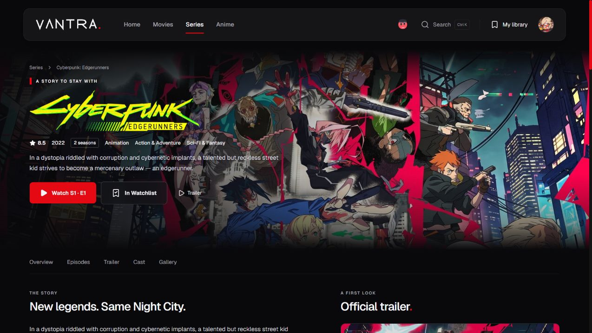

# VANTRA

A private web application for discovering movies, series and anime, managing a personal library, and tracking viewing progress.

Built with Next.js, React and Supabase, VANTRA combines catalogue metadata, personal recommendations and playback through external embedded sources. It is a non-commercial project in active development, with access restricted to approved accounts.



## Features

- **Discovery:** searchable movie, series and anime catalogues with filters, trailers, cast profiles and episode information. Lists load 18 titles at a time.
- **Personal library:** watching statuses, custom collections, private ratings and notes kept separate from catalogue scores.
- **Episode tracking:** manual watched marks for individual episodes or released seasons, with season counts and undo for bulk marks.
- **Continue watching:** up to three titles based on watched marks or the last episode opened. Caught-up titles and future episodes are excluded.
- **Recommendations:** suggestions based on library activity, with saved and previously opened titles filtered out.
- **Film collections:** release-order lists with private watched progress and verified links between selected connected film worlds.
- **Nook:** an animated companion that selects titles from the planned list or a broader discovery catalogue, presents community reviews, and supports optional accessories. It remains hidden during playback.
- **Account tools:** profile and avatar settings, private library statistics, and an owner-only database and file-storage capacity panel.
- **Responsive interface:** a shared visual theme, animated navigation and search, and reduced-motion support.

## How it works

TMDB supplies movie and series metadata, artwork and cast information. AniList provides anime metadata through GraphQL. Server routes validate requests, keep the TMDB API key private, and use bounded metadata caches, shared in-flight requests and upstream cooldowns.

Supabase handles authentication, PostgreSQL data and avatar storage. Access is restricted to approved accounts through an email whitelist. Row Level Security limits profiles, saved titles, history, reviews, collections and watched marks to their owner.

Personal data stays outside the shared catalogue cache. Account verification, ownership filters and database policies protect private operations.

## Playback and limitations

Playback uses external providers embedded in iframes. VANTRA does not host or upload video files. Availability, video controls, subtitles, quality settings and playback positions depend on the selected source.

Some sources display advertisements or open popups, including sources without an `ADS` badge. An updated browser and a reputable content blocker are recommended. These measures reduce unwanted content but do not guarantee safety or availability.

Watch history records titles and episodes opened, not confirmed completion. Episode progress relies on manual marks. An equivalent title stored separately in TMDB and AniList is not automatically matched across both catalogues.

The owner capacity panel measures current database and stored-file sizes. Monthly traffic, active users and other billing totals remain in the Supabase dashboard.

## Tech stack

| Technology | Role |
|---|---|
| Next.js 16 and React 19 | App Router, server routes and interface |
| TypeScript | Application types and request validation |
| CSS Modules and Tailwind CSS 4 | Shared theme and responsive styling |
| Framer Motion | Interface transitions and animations |
| Supabase | Authentication, PostgreSQL, RLS and avatar storage |
| TMDB | Movie, series, artwork and people data |
| AniList | Anime metadata and community recommendations |

## Run locally

Use Node.js 24 and npm. The test suite uses Node's native TypeScript support.

```sh
git clone https://github.com/balusikf/Vantra.git
cd Vantra
npm ci
cp .env.example .env.local
```

Fill in `.env.local`:

| Variable | Purpose |
|---|---|
| `NEXT_PUBLIC_SUPABASE_URL` | Supabase project URL |
| `NEXT_PUBLIC_SUPABASE_ANON_KEY` | Public publishable key or legacy anon key |
| `TMDB_API_KEY` | Server-side TMDB API key |
| `VANTRA_OWNER_USER_ID` | Optional server-only UUID for the capacity panel; must match its database authorization |

Keep `.env.local` private. A Supabase service-role or secret key must never be placed in a `NEXT_PUBLIC_` variable.

The app requires a prepared Supabase project with VANTRA's tables, RLS policies, functions, approved accounts and avatar bucket. The files in [docs/sql](docs/sql) record changes already applied to the existing project. They are deployment references, not a fresh-project installer. Review their notes before using them on another database.

```sh
npm run dev
```

Open [localhost:3000](http://localhost:3000) and sign in with an approved account. Restart the server after changing environment variables.

For a local production build:

```sh
npm run build
npm start
```

## Validation

```sh
npm test
npm run lint
npm run build
```

## Documentation

- [Personal recommendations and end-to-end checks](docs/FOR-YOU.md)
- [Continue watching and its limits](docs/CONTINUE-WATCHING.md)
- [Library tracking and collections](docs/LIBRARY-TRACKING.md)
- [Film collections and release order](docs/FILM-COLLECTIONS.md)
- [Nook and its appearance](docs/NOOK.md)
- [Automatic owner capacity panel](docs/OWNER-USAGE-PANEL.md)
- [Code audit and regression fixes](docs/CODE-AUDIT-2026-10-25.md)
- [Responsive layout review](docs/MOBILE-REVIEW-2026-10-25.md)
- [Embedded-player security](docs/PLAYER-SECURITY.md)

## Credits

Developed with assistance from [Claude](https://claude.ai) and Codex.

- Movie and series data and artwork: [TMDB](https://www.themoviedb.org/).
- Anime data: [AniList](https://anilist.co/).
- Nook is adapted from [bloub by Jérémy Perret](https://github.com/jeremy-prt/bloub). Its [MIT license](src/vendor/bloub/LICENSE) is retained with the vendored code.
