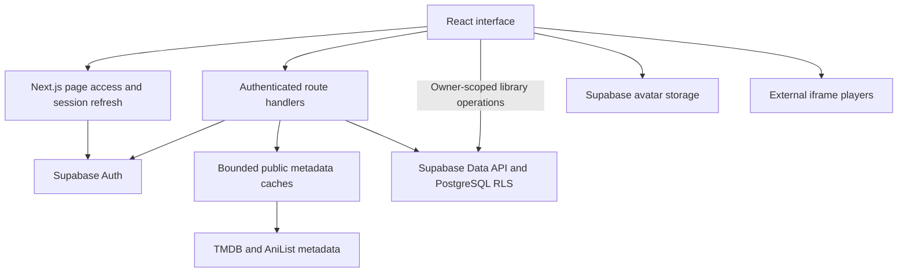
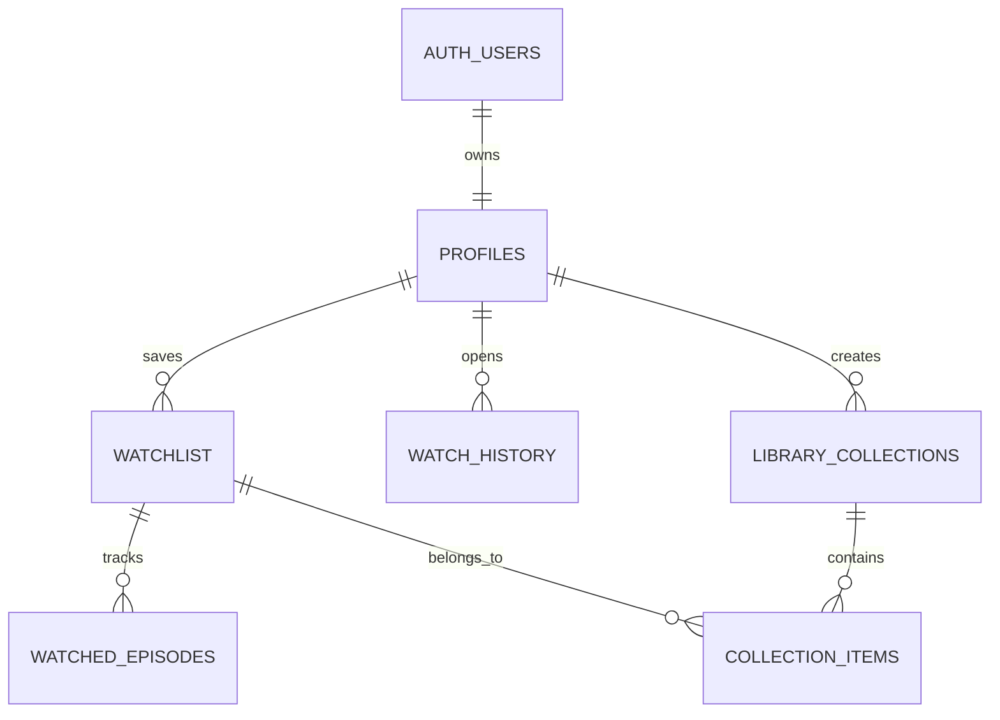

# Architecture

[Documentation](README.md) / Architecture

VANTRA separates public catalogue metadata, private account data and external video playback. It does not store a copy of the movie catalogue or video files in PostgreSQL.

## Request paths

The page proxy verifies page access and refreshes session cookies. API routes perform their own authoritative verification; the proxy avoids a duplicate API Auth round trip. Some private library operations use the browser Supabase client directly, with ownership filters and database RLS.

Public metadata can be shared through catalogue caches. Profiles, personal notes, saved titles, statistics and sessions cannot enter that cache. Private API responses use `private, no-store`.

## Data model

The diagram shows the active library relationships, not every administrative or historical table.

| Entity | Stored information |
| --- | --- |
| `profiles` | Display name and avatar reference |
| `watchlist` | Saved title identity, watching status, private score and note |
| `watch_history` | Most recently opened episode or title, one row per catalogue identity |
| `watched_episodes` | Explicit watched marks, keyed by saved title, season and episode |
| `library_collections` | Named owner collections and presentation settings |
| `collection_items` | Membership and ordering, linked to saved titles |

Deleting a saved title removes its attached private review and dependent episode marks and memberships through the existing relationships. Watch history is separate: removing a history entry does not remove the saved title or its review.

Episode state is read through `episode_tracking_state`, combining title lookup, season counts and the requested marks in one client RPC. A single RPC can execute several SQL statements; one API request is not one database statement.

## Media identity

| Context | Identity |
| --- | --- |
| Movies and series | TMDB ID plus media type |
| Anime catalogue, library and manual marks | AniList ID |
| Anime playback | Provider-specific MAL or AniList ID; some sources require a resolved file ID |
| Anime artwork | Verified local mapping to TMDB, with season/date alignment checks |

Equivalent TMDB and AniList entries are not automatically merged. A similar name is insufficient to establish a matching title, cour or episode.

## Operating boundaries

- Catalogue pages contain 18 titles; anime episode ranges contain 24 episodes.
- Upstream deadlines, coalescing and cooldowns bound metadata work.
- Process-local queues and quotas reset on restart and are separate on each server instance.
- Video, subtitles and audio controls belong to the external player unless it exposes an integration.
- Nook is mounted only where needed and is absent during playback.
- The owner panel measures current database and stored-file capacity, not monthly billing totals.

See [Performance](PERFORMANCE.md), [Security](SECURITY.md) and [Playback](PLAYBACK.md) for the corresponding limits.
