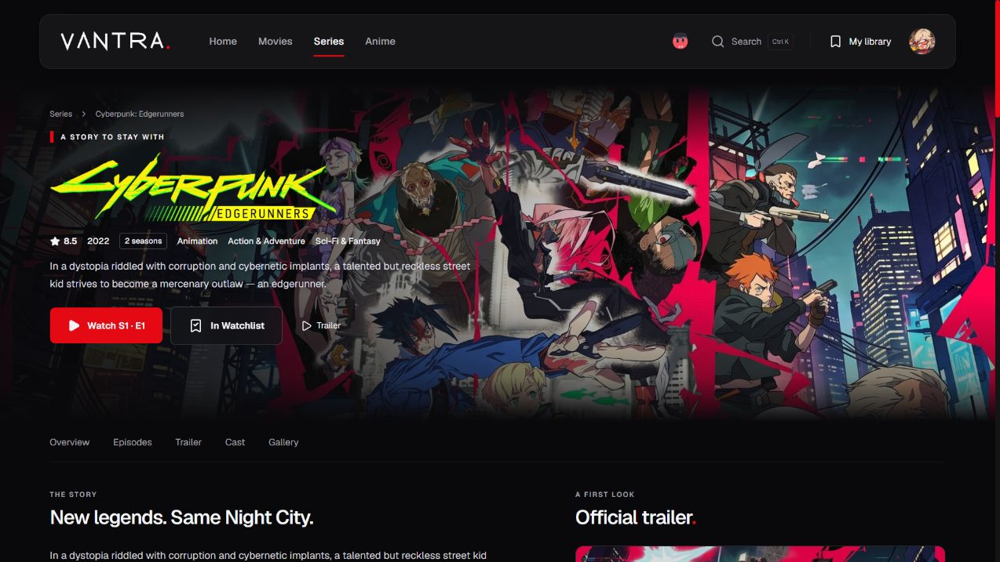
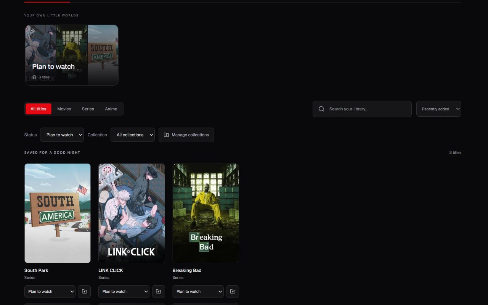
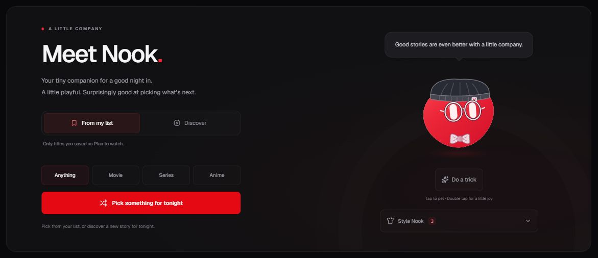
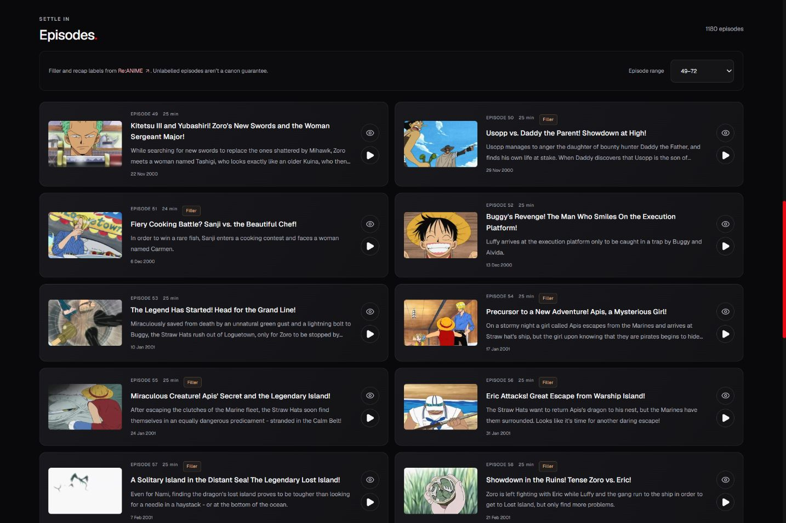

# Interface gallery

[Documentation](README.md) / Gallery

Selected desktop views of VANTRA. Catalogue artwork and available metadata can change. Screenshots show the interface, not a guarantee of playback availability.

## Title detail

Original title artwork, a cinematic backdrop and a shared layout for movies, series and anime.

## Personal library

Saved stories, personal organisation and private ratings stay separate from catalogue scores.

## Nook

The companion can suggest a planned title or discover something from the wider catalogue. Optional accessories follow his animated body and gaze.

## Playback recovery

An explicit retry when source discovery fails, with a route back through navigation.

## Anime episodes

Episode ranges, available metadata and explicit filler or recap labels.

