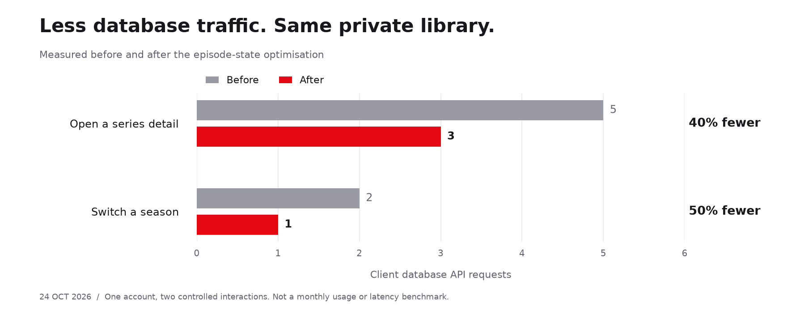

# Performance and database efficiency

[Documentation](README.md) / Performance

VANTRA reduces repeated reads, bounds the amount of private data returned and keeps catalogue metadata outside Supabase. The percentages below describe recorded interactions, not a universal speedup or a prediction of monthly costs.

## Measured database request reductions

<picture>
  <source media="(prefers-color-scheme: dark)" srcset="assets/database-requests-dark.png">
  
</picture>

| Scenario | Before | After | Fewer requests | Evidence |
| --- | ---: | ---: | ---: | --- |
| Open a series detail: client database calls | 5 | 3 | 40% | Recorded `/rest/v1/` request starts |
| Change season 1 to season 2 | 2 | 1 | 50% | Recorded `/rest/v1/` request starts |
| Open the same detail: client Auth checks | 3 | 1 | 66.7% | Recorded `/auth/v1/user` starts |
| Open the same detail: all client Supabase calls | 8 | 4 | 50% | Auth and database requests combined |

The rows overlap. Do not add their percentages or count the combined row as an additional saving.

### Method

The production-build comparison was recorded on **24 October 2026**, using the same signed-in account and TV detail route `/tv/105248`, followed by a season 1 to season 2 change. Temporary instrumentation recorded request start paths and timestamps only. It captured no headers, tokens, query parameters, identities or response bodies, and was removed afterward.

The chart is generated directly from the [anonymised request log](audit-2026-10-24-measurements.json). Its [derived data](assets/database-requests.json) records the units and exclusions. The [audit](AUDIT-2026-10-24.md) explains the implementation changes and broader checks.

These are **historical before/after measurements**, not a fresh benchmark of every feature in the current version. They exclude server-side verification, metadata requests, payload sizes and SQL statement counts. They do not measure latency, CPU time, query plans or total monthly egress.

## What changed

| Change | Effect |
| --- | --- |
| Shared account reads | Concurrent consumers reuse the current account request instead of independently verifying it |
| Episode-state RPC | Saved-title lookup, counts and watched marks are combined in one client request |
| Paginated library | Filtering and ordering run in the database; each page returns 18 entries |
| Database aggregation | Statistics and collection previews return bounded summaries instead of whole private tables |
| Compact continuation state | Watched ranges and first gaps avoid sending every episode row to the homepage |
| Batched released-season marking | Only missing, released episode marks are inserted; undo retains previous marks |
| Public metadata caching | Catalogue responses are reused without caching private account data alongside them |

## Other efficiency controls

The [22 October report](API-EFFICIENCY-2026-10-22.md) records separate tests of metadata reuse and outage backoff. The reported 90% reductions apply to ten immediate failed attempts becoming one upstream request in a controlled simulation. They are not 90% savings during normal successful browsing.

The main TMDB and AniList metadata fetches use hour-based server revalidation. The bounded browser metadata cache lasts five minutes. Concurrent cold requests share work, failures trigger short cooldowns, and abandoned client work is aborted. The anime episode-guide cache is separate and holds public responses for six hours.

Private statistics, recommendations and continuation checks run on demand, without a background database polling loop. The owner capacity panel is an exception: while visible, it refreshes on its documented schedule and shares successful server reads for 60 seconds.

## What this means for the Free plan

Fewer requests can reduce repeated work and response transfer. They do not reduce the number of monthly active users: one active person remains one MAU. API request counts alone cannot establish database CPU savings, billing reductions or the percentage of a monthly allowance saved.

Video is served externally. Catalogue artwork is not stored in the Supabase avatar bucket, although image delivery and optimisation can still consume hosting or upstream bandwidth. The owner capacity panel reports current database and file sizes; monthly egress and other billing totals remain in the Supabase dashboard.

## Rebuild the chart

This tooling is independent of the application's npm dependencies:

```sh
python -m pip install matplotlib
python docs/assets/generate.py
```

The generator also exports the transparent wordmark from the app's existing vector path. Light and dark assets adapt to the reader's GitHub theme. No external chart service, telemetry or account credentials are used.
