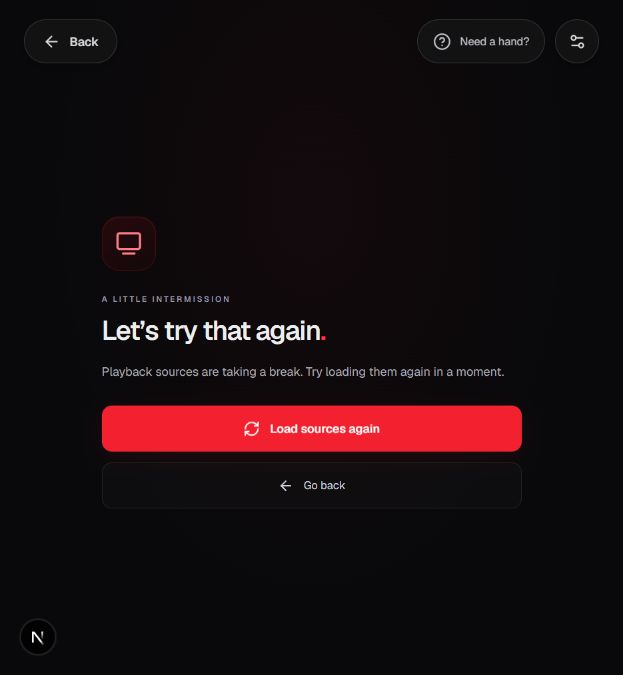
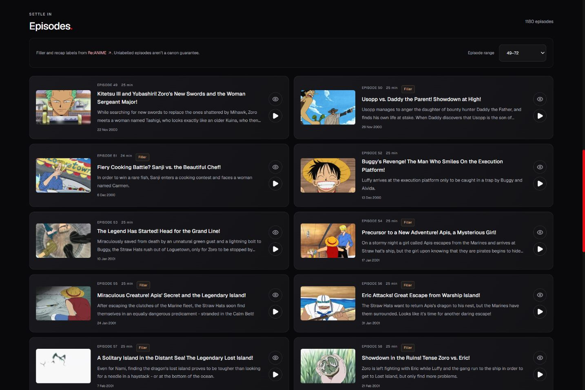

# Playback and anime episodes

[Documentation](README.md) / Playback

VANTRA selects external sources and embeds their players in iframes. It does not host video files or replace each source's internal controls.

## When playback needs help

Open **Need a hand?** in the player toolbar. On smaller screens, use the question-mark icon.

| Action | Behavior |
| --- | --- |
| Try another source | Advances to another available source for the same title and episode |
| Reload current player | Recreates the current iframe without changing the selected title |
| Load sources again | Retries the source-list request after it fails |
| Go back | Returns through browser navigation |

The toolbar hides when idle. Playback help opens only on request and supports keyboard navigation, Escape and focus restoration. The navbar and Nook remain absent during playback.

VANTRA cannot reliably inspect a cross-origin player's video state. An iframe loading does not confirm that the video is playing, and a black screen is not automatically treated as a detected failure. Source changes are deliberate user actions.

## Audio and subtitles

Audio languages, subtitle tracks, timing, quality, fullscreen behavior and position restoration depend on the selected player. Look inside its own settings. An anime-specific source may offer multiple audio tracks, but coverage is not universal.

VANTRA does not currently provide a universal subtitle upload, subtitle synchronisation layer or unified video controls across all iframe sources. These require a supported player API or a compatible direct stream.

## Advertising and browser safety

Some sources display advertisements or open unwanted tabs, including sources without an `ADS` badge. Availability and reliability vary by title, episode, location and time.

Use an updated browser and a reputable content blocker. These reduce unwanted requests and popups but cannot guarantee safety. Ignore third-party download, permission, installation and sign-up prompts. The application's restricted iframe permissions are not a complete ad blocker.

## Anime episode guides

Anime details use the same episode-row design as series. Long lists are divided into 24-episode ranges. When guide metadata is available, rows can include an episode title, synopsis, runtime, date and thumbnail.

**Filler** and **Recap** appear only when the selected episode guide explicitly supplies those flags. An unlabelled episode is not guaranteed to be canon. The guide attribution links to its source in the interface.

Matching requires the exact catalogue identity, not just a similar title. Returned episode numbers are restricted to the requested range, and an available MAL link must agree with the requested anime. Trusted image paths are validated before use. Missing mappings or guide outages leave ordinary playback available with honest metadata fallbacks.

## Progress and history

Opening a player records a title or episode in watch history. It does not prove completion. Use the episode's eye button for a watched mark; season-wide marking is available for released series episodes.

Continue watching displays at most three eligible titles. Caught-up titles and future releases are excluded. Without watched marks, it resumes the last episode opened instead of assuming the next one was reached.

See [Library tracking](LIBRARY-TRACKING.md), [Continue watching](CONTINUE-WATCHING.md) and [Security](SECURITY.md).
